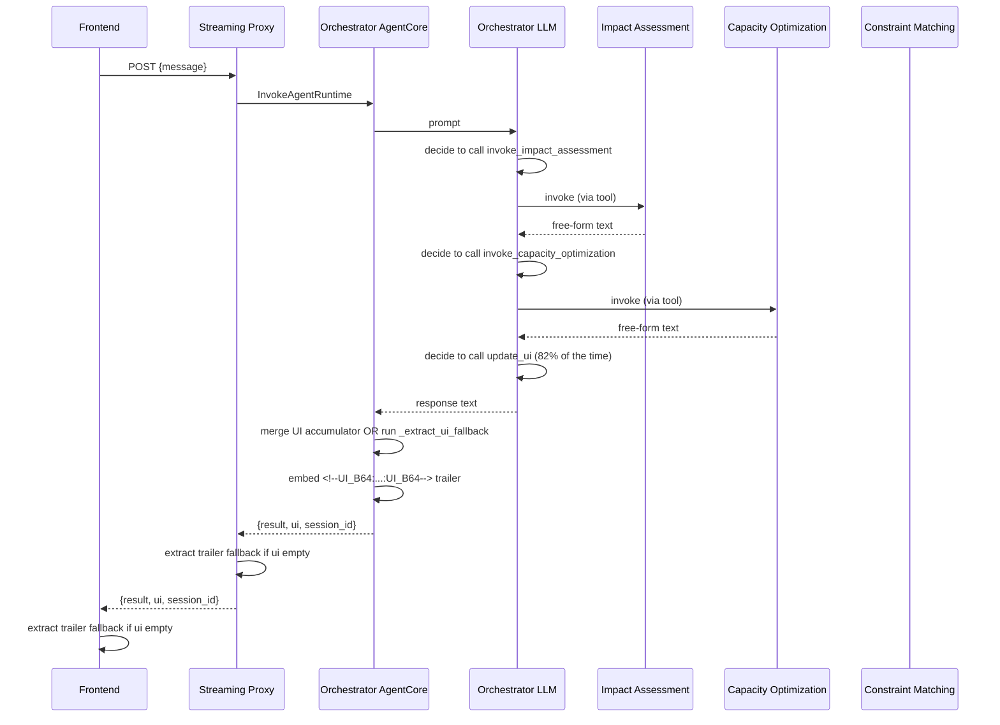
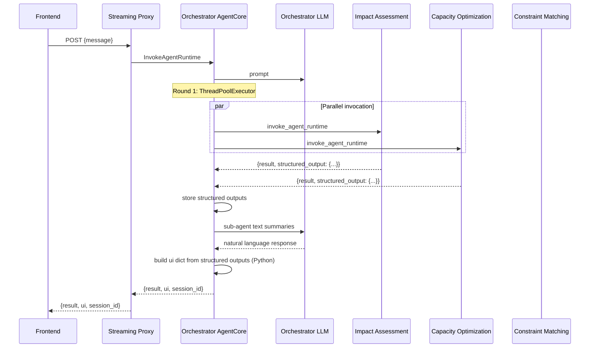

# Design Document: Deterministic JSON Pipeline

## Overview

This design reworks the orchestrator agent's response pipeline to replace LLM-driven JSON formatting with deterministic structured outputs. The current system relies on the LLM calling an `update_ui` tool (~82% accuracy), embeds UI data as base64 trailers in response text, and falls back to regex extraction when the tool isn't called. The new architecture:

1. Sub-agents (Impact Assessment, Capacity Optimization, Constraint Matching) use Strands `structured_output_model` to return validated Pydantic objects.
2. Each sub-agent's `agentcore_server.py` serializes the structured output into the response payload under a `structured_output` key.
3. The orchestrator's `agentcore_server.py` builds the `ui` dict deterministically in Python from sub-agent structured outputs — no LLM involvement.
4. Round 1 uses `concurrent.futures.ThreadPoolExecutor` for guaranteed parallel sub-agent invocation.
5. The `update_ui` tool, UI accumulator, trailer system, and fallback extractor are all removed.
6. The streaming proxy and frontend are simplified to read `ui` from the JSON envelope directly.

The existing `UiPayload` Pydantic model and frontend `UiPayload` TypeScript interface remain unchanged — this is a pipeline-only change.

## Architecture

### Current Architecture (Before)



### New Architecture (After)



### Key Design Decisions

1. **Orchestrator stays as a chat agent**: The orchestrator LLM still handles reasoning, what-if questions, planner interaction, and workflow phase management. It does NOT use `structured_output_model` — only sub-agents do.

2. **`concurrent.futures.ThreadPoolExecutor` for Round 1**: Rather than relying on the LLM to emit both `invoke_impact_assessment` and `invoke_capacity_optimization` tool calls in a single turn, the orchestrator's `agentcore_server.py` detects Round 1 and dispatches both invocations in parallel via Python threading. The LLM receives the combined results.

3. **Sub-agent structured output via Strands SDK**: Each sub-agent's `Agent()` constructor gets a `structured_output_model=<PydanticModel>` parameter. The Strands SDK constrains the LLM's final response to conform to that schema. The sub-agent's `agentcore_server.py` extracts the structured output from the agent result object.

4. **UI assembly in Python code**: The orchestrator's `agentcore_server.py` maps structured output fields to `UiPayload` fields using deterministic Python dict construction. No LLM formatting, no regex, no trailers.

5. **Existing UiPayload schema preserved**: Both the Pydantic `UiPayload` model and the TypeScript `UiPayload` interface remain unchanged. Frontend components need zero modifications.


## Components and Interfaces

### 1. Sub-Agent Structured Output Pydantic Models

Each sub-agent gets a new Pydantic model that serves as its `structured_output_model`. These models capture the essential data the orchestrator needs to build the `ui` dict.

#### ImpactAssessmentOutput

Defined in `impact-assessment-agent/src/impact_assessment_agent/models/schemas.py`:

```python
class ImpactAssessmentOutput(BaseModel):
    """Structured output for Impact Assessment Agent.
    
    Used as structured_output_model in Agent() constructor.
    Contains scored orders, priority summary, and total value
    needed by the orchestrator to build the Round 1 UI payload.
    """
    scored_orders: list[ScoredOrder]
    priority_summary: PrioritySummary
    total_value: float = Field(0.0, ge=0.0)
    summary_text: str = ""
```

#### CapacityOptimizationOutput

Defined in `capacity-optimization-agent/src/capacity_optimization_agent/models/schemas.py`:

```python
class CapacityOptimizationOutput(BaseModel):
    """Structured output for Capacity Optimization Agent.
    
    Used as structured_output_model in Agent() constructor.
    Contains capacity snapshot summary, delay candidates,
    surplus, and bottleneck data for the orchestrator.
    """
    utilization: list[MachineUtilizationSummary] = []
    manpower_utilization_pct: float = 0.0
    material_utilization_pct: float = 0.0
    bottleneck: str = ""
    delay_candidates: list[DelayCandidateSummary] = []
    surplus_summary: SurplusSummary | None = None
    summary_text: str = ""


class MachineUtilizationSummary(BaseModel):
    """Simplified utilization for structured output."""
    machine_type: str
    normal_utilization_pct: float = 0.0
    total_surplus_hours: float = 0.0


class DelayCandidateSummary(BaseModel):
    """Simplified delay candidate for structured output."""
    order_id: str
    product_family: str
    customer_id: str
    customer_tier: str
    order_value: float = 0.0
    due_date: str = ""
    slack_days: int = 0
    freed_rolling_mill_hours: float = 0.0
    freed_finishing_line_hours: float = 0.0
    freed_material_tons: float = 0.0
    risk_level: str = "Low"
    trade_off_explanation: str = ""
```

#### ConstraintMatchingOutput

Defined in `constraint-matching-agent/src/constraint_matching_agent/models/schemas.py`:

```python
class ConstraintMatchingOutput(BaseModel):
    """Structured output for Constraint Matching Agent.
    
    Used as structured_output_model in Agent() constructor.
    Contains funnel results per order with per-layer pass/fail,
    recommendation, and reasoning.
    """
    funnel_results: list[FunnelOrderSummary] = []
    transfer_summary: TransferSummary | None = None
    summary_text: str = ""


class FunnelOrderSummary(BaseModel):
    """Per-order funnel result for structured output."""
    order_id: str
    priority: str
    product_family: str = ""
    customer_id: str = ""
    customer_tier: str = ""
    order_value: float = 0.0
    due_date: str = ""
    all_layers_passed: bool = False
    recommendation: str = ""
    recommendation_category: str = "Non-transferable"
    reasoning: str = ""
    layers: list[FunnelLayerSummary] = []


class FunnelLayerSummary(BaseModel):
    """Single funnel layer result."""
    layer: int
    name: str
    passed: bool
    detail: str = ""
```

### 2. Sub-Agent AgentCore Server Changes

Each sub-agent's `agentcore_server.py` extracts the structured output from the Strands agent result and includes it in the response:

```python
# Pattern for all three sub-agent agentcore_server.py files
@app.entrypoint
def invoke(payload, context):
    agent = _create_agent_per_request(session_id=session_id)
    result = run_agent(agent, prompt, session_id)

    if result.success:
        # Extract structured output from Strands agent result
        structured_output = None
        if hasattr(result, 'data') and result.data is not None:
            try:
                # Strands structured_output_model stores the parsed model
                # on the agent result. We serialize it to dict.
                if hasattr(result.data, 'model_dump'):
                    structured_output = result.data.model_dump()
                else:
                    # result.data is str from str(result) — parse if JSON
                    import json
                    parsed = json.loads(result.data)
                    if isinstance(parsed, dict):
                        structured_output = parsed
            except (json.JSONDecodeError, TypeError):
                pass

        response = {"result": str(result.data), "session_id": session_id}
        if structured_output:
            response["structured_output"] = structured_output
        return response
    else:
        return {"error": result.error, "session_id": session_id, "success": False}
```

### 3. Sub-Agent Agent Factory Changes

Each sub-agent's `create_agent()` function adds the `structured_output_model` parameter:

```python
# Impact Assessment Agent
agent = Agent(
    model=model,
    system_prompt=get_full_system_prompt(),
    tools=mcp_tools + PYTHON_TOOLS,
    structured_output_model=ImpactAssessmentOutput,  # NEW
    **({"session_manager": session_manager} if session_manager else {}),
)

# Capacity Optimization Agent
agent = Agent(
    model=model,
    system_prompt=get_full_system_prompt(),
    tools=mcp_tools + PYTHON_TOOLS,
    structured_output_model=CapacityOptimizationOutput,  # NEW
    **({"session_manager": session_manager} if session_manager else {}),
)

# Constraint Matching Agent
agent = Agent(
    model=model,
    system_prompt=get_full_system_prompt(),
    tools=mcp_tools + PYTHON_TOOLS,
    structured_output_model=ConstraintMatchingOutput,  # NEW
    **({"session_manager": session_manager} if session_manager else {}),
)
```

### 4. Orchestrator `_invoke_sub_agent` Changes

The orchestrator's `_invoke_sub_agent` helper parses the `structured_output` field from sub-agent responses and stores it in a module-level accumulator:

```python
# Module-level structured output accumulator
_structured_outputs: dict[str, dict] = {}

def _reset_structured_outputs() -> None:
    global _structured_outputs
    _structured_outputs = {}

def _get_structured_outputs() -> dict[str, dict]:
    return _structured_outputs

def _invoke_sub_agent(agent_arn: str, prompt: str, name: str) -> str:
    """Invoke sub-agent, extract structured_output, return text to LLM."""
    # ... existing retry logic ...
    response = _agentcore_client.invoke_agent(...)
    
    # Parse structured output from response
    try:
        parsed = json.loads(response.output_text)
        if isinstance(parsed, dict) and "structured_output" in parsed:
            _structured_outputs[name] = parsed["structured_output"]
            text = parsed.get("result", response.output_text)
        else:
            text = response.output_text
    except (json.JSONDecodeError, TypeError):
        text = response.output_text
    
    return f"[SUCCESS — {name} completed in {duration_ms}ms]\n{text}"
```

### 5. Orchestrator AgentCore Server — Deterministic UI Assembly

The orchestrator's `agentcore_server.py` `invoke()` function builds the `ui` dict from structured outputs:

```python
@app.entrypoint
def invoke(payload, context):
    from orchestrator_agent.agent import (
        run_agent, _reset_structured_outputs, _get_structured_outputs,
    )
    
    _reset_structured_outputs()
    agent = _create_agent_per_request(session_id=session_id, plant=plant)
    
    # Round 1 parallel invocation (see section below)
    # ... or normal LLM-driven invocation for other phases ...
    
    result = run_agent(agent, effective_prompt, session_id)
    
    # Build ui dict deterministically from structured outputs
    ui = _build_ui_payload(_get_structured_outputs(), current_phase)
    
    if result.success:
        return {
            "result": result.data,
            "ui": ui,
            "session_id": session_id,
        }
```

The `_build_ui_payload` function maps structured outputs to `UiPayload` fields:

```python
def _build_ui_payload(
    structured_outputs: dict[str, dict],
    phase: str,
) -> dict:
    """Build UiPayload dict from sub-agent structured outputs.
    
    Pure Python — no LLM involvement. Maps structured output fields
    to the existing UiPayload schema that the frontend expects.
    """
    ui: dict = {}
    
    ia_output = structured_outputs.get("Impact Assessment Agent")
    co_output = structured_outputs.get("Capacity & Optimization Agent")
    cm_output = structured_outputs.get("Constraint Matching Agent")
    
    # Round 1 complete: both IA and CO outputs present
    if ia_output and co_output:
        ui["phase"] = "round1_complete"
        
        # Orders from Impact Assessment
        orders = []
        for o in ia_output.get("scored_orders", []):
            orders.append({
                "orderId": o["order_id"],
                "product": o.get("product_family", ""),
                "customer": o.get("customer_name", ""),
                "customerTier": o.get("customer_tier", ""),
                "value": f"${o.get('order_value', 0):,.0f}",
                "dueDate": o.get("due_date", ""),
                "priority": o.get("priority", ""),
            })
        ui["orders"] = orders
        
        # Capacity from Capacity Optimization
        util = co_output.get("utilization", [])
        rm_pct = next((u["normal_utilization_pct"] for u in util 
                       if u["machine_type"] == "Rolling Mill"), 0)
        fl_pct = next((u["normal_utilization_pct"] for u in util 
                       if u["machine_type"] == "Finishing Line"), 0)
        ui["capacity"] = {
            "rollingMill": rm_pct,
            "finishingLine": fl_pct,
            "rawMaterial": co_output.get("material_utilization_pct", 0),
            "manpower": co_output.get("manpower_utilization_pct", 0),
        }
        
        # Priorities from Impact Assessment
        ps = ia_output.get("priority_summary", {})
        ui["priorities"] = {
            "P1": ps.get("p1_count", 0),
            "P2": ps.get("p2_count", 0),
            "P3": ps.get("p3_count", 0),
            "P1Value": f"${ps.get('p1_total_value', 0):,.0f}",
            "P2Value": f"${ps.get('p2_total_value', 0):,.0f}",
            "P3Value": f"${ps.get('p3_total_value', 0):,.0f}",
        }
        
        ui["totalOrders"] = ps.get("total_orders", len(orders))
        ui["totalValue"] = f"${ia_output.get('total_value', 0):,.0f}"
        ui["bottleneck"] = co_output.get("bottleneck", "")
    
    # Constraint funnel results
    if cm_output:
        funnel_results = cm_output.get("funnel_results", [])
        if funnel_results:
            ui["phase"] = "constraint_funnel"
            # Build transferOrders from approved funnel results
            transfer_orders = []
            for fr in funnel_results:
                if fr.get("all_layers_passed", False):
                    transfer_orders.append({
                        "orderId": fr["order_id"],
                        "product": fr.get("product_family", ""),
                        "customer": fr.get("customer_id", ""),
                        "customerTier": fr.get("customer_tier", ""),
                        "value": f"${fr.get('order_value', 0):,.0f}",
                        "dueDate": fr.get("due_date", ""),
                        "priority": fr.get("priority", ""),
                        "recommendation": fr.get("recommendation", ""),
                        "reasoning": fr.get("reasoning", ""),
                        "funnelResults": [
                            {"layer": l["layer"], "name": l["name"],
                             "passed": l["passed"], "detail": l.get("detail", "")}
                            for l in fr.get("layers", [])
                        ],
                    })
            if transfer_orders:
                ui["transferOrders"] = transfer_orders
    
    return ui
```

### 6. Round 1 Parallel Invocation

The orchestrator's `agentcore_server.py` detects Round 1 and dispatches both sub-agents in parallel:

```python
from concurrent.futures import ThreadPoolExecutor, as_completed

def _invoke_round1_parallel(session_id: str, plant: str) -> dict[str, str]:
    """Invoke IA and CO sub-agents in parallel for Round 1.
    
    Returns dict mapping agent name to text result.
    Stores structured outputs in the module-level accumulator.
    """
    settings = _settings_cached
    
    def invoke_ia():
        return _invoke_sub_agent(
            agent_arn=settings.impact_assessment_agent_arn,
            prompt=f"Analyze and prioritize all active {plant} orders",
            name="Impact Assessment Agent",
        )
    
    def invoke_co():
        return _invoke_sub_agent(
            agent_arn=settings.capacity_optimization_agent_arn,
            prompt=f"Analyze Ohio plant capacity for absorbing {plant} orders",
            name="Capacity & Optimization Agent",
        )
    
    results = {}
    with ThreadPoolExecutor(max_workers=2) as executor:
        futures = {
            executor.submit(invoke_ia): "Impact Assessment Agent",
            executor.submit(invoke_co): "Capacity & Optimization Agent",
        }
        for future in as_completed(futures):
            name = futures[future]
            try:
                results[name] = future.result()
            except Exception as e:
                results[name] = f"{name} failed: {str(e)}"
    
    return results
```

### 7. Orchestrator Agent.py Changes

Removals from `orchestrator_agent/agent.py`:
- `update_ui` tool function
- `_ui_payloads` list, `_reset_ui_accumulator`, `_get_ui_payloads`, `_append_ui_payload`
- `update_ui` from `PYTHON_TOOLS` list

Additions:
- `_structured_outputs` dict, `_reset_structured_outputs`, `_get_structured_outputs`
- Updated `_invoke_sub_agent` to parse `structured_output` from responses

The `PYTHON_TOOLS` list becomes:
```python
PYTHON_TOOLS = [
    invoke_impact_assessment,
    invoke_capacity_optimization,
    invoke_constraint_matching,
    get_session_state,
    update_session_phase,
    # update_ui REMOVED
]
```

### 8. Orchestrator System Prompt Simplification

Sections removed from the system prompt:
- "CRITICAL: Structured UI Updates" (entire section with update_ui instructions)
- "CRITICAL: Capacity Impact Updates" (entire section)
- "CRITICAL: Transfer Orders on Funnel Completion" (entire section)
- All references to `update_ui` tool in workflow phase instructions

Section added:
```
## Structured Data Handling
Structured UI data (orders, capacity, approval requests, capacity impact)
is handled automatically by the server from sub-agent structured outputs.
Your role is to provide natural language responses for the chat display.
Focus on summarizing findings, presenting recommendations, and interacting
with the Planner. Do NOT attempt to format JSON or structured data.
```

Sections preserved unchanged:
- Workflow phases (1-6)
- Sub-agent tool descriptions
- MCP tool descriptions
- Session tool descriptions
- Interaction rules
- Error handling
- Audit instructions
- Planner context
- Frontend phase context (updated to remove update_ui references)

### 9. Streaming Proxy Simplification

The streaming proxy (`infrastructure/streaming-proxy/index.mjs`) is simplified to:

1. Parse AgentCore response as JSON
2. Extract `result`, `ui`, `session_id` fields
3. Apply ALLOWED_UI_KEYS whitelist to `ui`
4. Forward `{result, ui, session_id}` to browser

Removed:
- Base64 trailer extraction (`<!--UI_B64:...:UI_B64-->` regex and decoding)
- Legacy trailer extraction (`<!--UI_DATA:...:UI_DATA-->` regex and parsing)

### 10. Frontend Streaming Simplification

The frontend `streaming.ts` `handleCompleteResponse` function is simplified to:

1. Parse JSON envelope
2. Extract `result` as display text
3. Extract `ui` as structured data
4. Attach `uiData` to message, pass to `parseResponse`

Removed:
- Base64 trailer extraction regex and `atob` decoding
- Legacy trailer extraction regex and JSON parsing
- All fallback extraction logic

### 11. Capacity Impact from Deterministic Computation

The Capacity Optimization Agent's `process_delay_decision` and `apply_constraint_tool` already compute capacity deterministically via `CapacityState`. They are extended to include a `capacityImpact` field in their return values:

```python
@tool
def process_delay_decision(order_id, action, florida_demand_json) -> str:
    # ... existing logic ...
    
    # Compute capacityImpact from CapacityState
    capacity_impact = _build_capacity_impact(
        _capacity_state, sender_plant="Florida", receiver_plant="Ohio"
    )
    
    return json.dumps({
        "order_id": order_id,
        "action": action,
        "surplus_after": after.total_surplus_summary.model_dump(),
        "bottleneck_after": after.bottleneck.model_dump(),
        "capacityImpact": capacity_impact,  # NEW
    }, default=str)


def _build_capacity_impact(
    state: CapacityState,
    sender_plant: str,
    receiver_plant: str,
) -> dict:
    """Build capacityImpact dict from CapacityState snapshot.
    
    Computes utilization percentages from the cached snapshot's
    MachineUtilization objects. Sender plant is at 0% (disrupted).
    """
    snapshot = state.snapshot
    
    rm_util = fl_util = 0.0
    rm_total = fl_total = 0.0
    for mu in snapshot.utilization:
        if mu.machine_type == "Rolling Mill":
            rm_util = mu.normal.utilization_pct
            rm_total = mu.normal.total_hours
        elif mu.machine_type == "Finishing Line":
            fl_util = mu.normal.utilization_pct
            fl_total = mu.normal.total_hours
    
    overall = (rm_util + fl_util) / 2 if (rm_util + fl_util) > 0 else 0
    
    return {
        "senderPlant": {
            "name": sender_plant,
            "rollingMill": {"current": 0, "projected": 0},
            "finishingLine": {"current": 0, "projected": 0},
            "overall": {"current": 0, "projected": 0},
        },
        "receiverPlant": {
            "name": receiver_plant,
            "rollingMill": {"current": round(rm_util, 1), "projected": round(rm_util, 1)},
            "finishingLine": {"current": round(fl_util, 1), "projected": round(fl_util, 1)},
            "overall": {"current": round(overall, 1), "projected": round(overall, 1)},
        },
    }
```


## Data Models

### Sub-Agent Response Envelope

All sub-agent `agentcore_server.py` responses follow this envelope:

```json
{
  "result": "<text summary for LLM reasoning>",
  "session_id": "<uuid>",
  "structured_output": { ... }  // Pydantic model serialized to dict
}
```

On error:
```json
{
  "error": "<error message>",
  "session_id": "<uuid>",
  "success": false
}
```

### Orchestrator Response Envelope

The orchestrator's `agentcore_server.py` returns:

```json
{
  "result": "<natural language chat text>",
  "ui": { ... },  // UiPayload dict, built deterministically
  "session_id": "<uuid>"
}
```

The `ui` field conforms to the existing `UiPayload` schema — no changes to the schema itself.

### Structured Output Accumulator

Module-level dict in `orchestrator_agent/agent.py`:

```python
_structured_outputs: dict[str, dict] = {}
# Key: agent name (e.g., "Impact Assessment Agent")
# Value: deserialized structured_output dict from sub-agent response
```

Reset at the start of each invocation via `_reset_structured_outputs()`.

### Data Flow Summary

```mermaid
flowchart TD
    subgraph Sub-Agents
        IA[Impact Assessment Agent]
        CO[Capacity Optimization Agent]
        CM[Constraint Matching Agent]
    end

    subgraph Orchestrator
        INV[_invoke_sub_agent]
        ACC[_structured_outputs accumulator]
        BUILD[_build_ui_payload]
        LLM[Orchestrator LLM]
    end

    subgraph Response Pipeline
        ENV[JSON Envelope]
        SP[Streaming Proxy]
        FE[Frontend]
    end

    IA -->|structured_output| INV
    CO -->|structured_output| INV
    CM -->|structured_output| INV
    INV -->|store structured data| ACC
    INV -->|text summary| LLM
    LLM -->|chat text| ENV
    ACC -->|structured outputs| BUILD
    BUILD -->|ui dict| ENV
    ENV -->|{result, ui, session_id}| SP
    SP -->|pass-through ui| FE
```

### Phase-to-UI Mapping

| Workflow Phase | Structured Output Source | UiPayload Fields Set |
|---|---|---|
| round1_complete | IA + CO | phase, orders, capacity, priorities, totalOrders, totalValue, bottleneck |
| delay_optimization | CO (process_delay_decision) | phase, approvalRequest, capacityImpact |
| constraint_funnel | CM (evaluate_funnel_tool) | phase, approvalRequest, funnelResults, capacityImpact |
| summary | CM (accumulated) | phase, complete, transferOrders |

### Existing Models Preserved (No Changes)

- `orchestrator_agent/models/schemas.py`: `UiPayload`, `UiOrder`, `UiCapacity`, `UiPriorities`, `UiApprovalRequest`, `UiCapacityImpact`, `UiTransferOrder` — all unchanged
- `frontend-spa/src/types/index.ts`: `UiPayload`, `UiOrder`, `UiCapacity`, etc. — all unchanged
- `frontend-spa/src/lib/responseParser.ts`: `parseResponse` — unchanged (still maps `uiData` to Zustand store)


## Correctness Properties

*A property is a characteristic or behavior that should hold true across all valid executions of a system — essentially, a formal statement about what the system should do. Properties serve as the bridge between human-readable specifications and machine-verifiable correctness guarantees.*

### Property 1: Sub-agent structured output schema conformance

*For any* valid ERP data input (orders, customers, equipment, materials, manpower), when a sub-agent (Impact Assessment, Capacity Optimization, or Constraint Matching) processes that input, the resulting structured output SHALL validate against its respective Pydantic model (`ImpactAssessmentOutput`, `CapacityOptimizationOutput`, or `ConstraintMatchingOutput`) without raising a `ValidationError`.

**Validates: Requirements 1.1, 1.2, 1.3**

### Property 2: Sub-agent response envelope contains structured_output

*For any* successful sub-agent invocation result, the response dict returned by the sub-agent's `agentcore_server.py` SHALL contain a `structured_output` key whose value is a non-empty dict that is a valid serialization of the agent's Pydantic output model.

**Validates: Requirements 1.7, 7.1, 7.2, 7.3**

### Property 3: Orchestrator extracts and accumulates structured outputs

*For any* sub-agent response containing a `structured_output` key, after `_invoke_sub_agent` processes that response, the `_structured_outputs` accumulator SHALL contain an entry keyed by the agent name whose value equals the `structured_output` dict from the response.

**Validates: Requirements 2.1, 8.1, 8.2**

### Property 4: UI assembly determinism

*For any* dict of structured outputs and workflow phase string, calling `_build_ui_payload` twice with the same arguments SHALL produce identical `ui` dicts (i.e., `_build_ui_payload` is a pure function with no side effects or randomness).

**Validates: Requirements 2.2**

### Property 5: Round 1 UI payload completeness

*For any* valid pair of Impact Assessment and Capacity Optimization structured outputs, the `ui` dict produced by `_build_ui_payload` SHALL contain all of: `phase` (equal to `"round1_complete"`), `orders` (non-empty list), `capacity` (with `rollingMill` and `finishingLine` keys), `priorities` (with `P1`, `P2`, `P3` keys), `totalOrders` (integer), `totalValue` (string), and `bottleneck` (string).

**Validates: Requirements 2.3, 13.3**

### Property 6: Delay optimization UI payload assembly

*For any* valid Capacity Optimization structured output containing a delay decision result with `capacityImpact`, the `ui` dict produced for the `delay_optimization` phase SHALL contain `approvalRequest` (with `orderId`) and `capacityImpact` (with `senderPlant` and `receiverPlant` sub-objects).

**Validates: Requirements 2.4**

### Property 7: Constraint funnel UI payload assembly

*For any* valid Constraint Matching structured output containing funnel results, the `ui` dict produced for the `constraint_funnel` phase SHALL contain `approvalRequest` (with `orderId` and `funnelResults`) and `capacityImpact`.

**Validates: Requirements 2.5**

### Property 8: Summary UI payload assembly

*For any* non-empty list of accumulated funnel approvals (orders where `all_layers_passed` is true), the `ui` dict produced for the `summary` phase SHALL contain `complete` equal to `true` and `transferOrders` as a non-empty list where each entry has `orderId`, `recommendation`, `reasoning`, and `funnelResults` fields.

**Validates: Requirements 2.6**

### Property 9: No trailers in orchestrator result text

*For any* orchestrator response, the `result` string in the response envelope SHALL NOT contain the substrings `<!--UI_B64:` or `<!--UI_DATA:`.

**Validates: Requirements 4.1**

### Property 10: Empty ui when no structured outputs accumulated

*For any* orchestrator invocation where no sub-agents returned structured outputs (i.e., `_structured_outputs` is empty), the `ui` field in the response envelope SHALL be an empty dict `{}`.

**Validates: Requirements 5.3**

### Property 11: capacityImpact structure from deterministic computation

*For any* valid `CapacityState` snapshot, the `capacityImpact` dict produced by `_build_capacity_impact` SHALL contain `senderPlant` and `receiverPlant` objects, each with `name` (string), `rollingMill` (with `current` and `projected` floats), `finishingLine` (with `current` and `projected` floats), and `overall` (with `current` and `projected` floats). Furthermore, calling `_build_capacity_impact` twice with the same `CapacityState` SHALL produce identical results.

**Validates: Requirements 6.1, 6.2, 6.3, 6.4**

### Property 12: Streaming proxy ui pass-through

*For any* valid AgentCore response JSON containing `result`, `ui`, and `session_id` fields, the streaming proxy SHALL forward a response where the `ui` field contains exactly the keys from the input `ui` that are in the ALLOWED_UI_KEYS whitelist, with values unchanged.

**Validates: Requirements 4.3, 12.1, 12.2**

### Property 13: Text summary returned alongside structured output

*For any* sub-agent response containing both `result` (text) and `structured_output` (dict), the `_invoke_sub_agent` helper SHALL return a non-empty string (the text summary) to the caller AND store the structured output in the accumulator. Both outputs are present — neither is dropped.

**Validates: Requirements 8.4**

### Property 14: Frontend envelope extraction

*For any* JSON envelope string containing a non-empty `ui` object, the frontend's `handleCompleteResponse` function SHALL attach the `ui` object as `uiData` on the message and pass it to `parseResponse`.

**Validates: Requirements 9.1, 9.3**

### Property 15: UiPayload JSON round-trip

*For any* valid `UiPayload` Pydantic model instance, serializing to JSON via `model_dump_json()` and deserializing back via `UiPayload.model_validate_json()` SHALL produce an equivalent object (all field values match).

**Validates: Requirements 10.4**

### Property 16: Parallel Round 1 invocation

*For any* Round 1 invocation, the Impact Assessment and Capacity Optimization sub-agents SHALL be invoked via `concurrent.futures.ThreadPoolExecutor` (or equivalent), and both invocations SHALL execute concurrently (i.e., the second invocation starts before the first completes).

**Validates: Requirements 13.1**

### Property 17: Orchestrator response envelope structure

*For any* successful orchestrator invocation, the response dict SHALL contain exactly three top-level keys: `result` (string), `ui` (dict), and `session_id` (string).

**Validates: Requirements 2.7**


## Error Handling

### Sub-Agent Structured Output Validation Failure

When a sub-agent's Strands `structured_output_model` fails Pydantic validation (e.g., the LLM produces output that doesn't conform to the schema), the sub-agent's `agentcore_server.py` catches the `ValidationError` and returns:

```json
{
  "error": "Structured output validation failed: <pydantic error details>",
  "session_id": "<uuid>",
  "success": false
}
```

The orchestrator's `_invoke_sub_agent` helper treats this as a failed invocation — no `structured_output` is stored, and the error text is returned to the orchestrator LLM for reasoning.

### Sub-Agent Invocation Failure

Existing retry logic in `_invoke_sub_agent` is preserved. On permanent failure:
- The error is recorded in the session via `session.record_error()`
- The text error message is returned to the orchestrator LLM
- No `structured_output` is stored in the accumulator
- The `_build_ui_payload` function handles missing agent outputs gracefully (only builds UI fields for agents that returned data)

### Round 1 Partial Failure

If one Round 1 sub-agent fails while the other succeeds:
- The `ThreadPoolExecutor` catches the exception for the failed future
- The successful agent's structured output is stored in the accumulator
- `_build_ui_payload` builds a partial UI payload from the available data
- The orchestrator LLM receives both the success text and the error text, and communicates the partial failure to the Planner

### Missing structured_output in Sub-Agent Response

If a sub-agent response doesn't contain a `structured_output` key (e.g., the agent was invoked before the `structured_output_model` change was deployed):
- `_invoke_sub_agent` falls back to returning the raw text to the LLM
- No structured output is stored
- The `ui` dict will be empty for that agent's contribution
- The system degrades gracefully — chat still works, just without structured UI components

### Empty UI Payload

When no structured outputs are accumulated (e.g., conversational messages, what-if questions that don't invoke sub-agents), the orchestrator returns `"ui": {}`. The frontend handles this by displaying plain text in the chat with no structured UI components — this is the correct behavior for non-workflow messages.

## Testing Strategy

### Property-Based Testing

Property-based tests use the `hypothesis` library (Python) and `fast-check` (TypeScript/frontend) with a minimum of 100 iterations per property test.

Each property test is tagged with a comment referencing the design property:
```python
# Feature: deterministic-json-pipeline, Property 1: Sub-agent structured output schema conformance
```

#### Python Property Tests

| Property | Test Location | Generator Strategy |
|---|---|---|
| P1: Schema conformance | `tests/test_structured_output.py` | Generate random orders, customers, equipment via Hypothesis strategies; invoke scoring/capacity/funnel engines; validate output against Pydantic model |
| P2: Response envelope | `tests/test_agentcore_server.py` | Generate random valid agent results; verify response dict contains `structured_output` |
| P3: Accumulator extraction | `tests/test_invoke_helper.py` | Generate random response dicts with/without `structured_output`; verify accumulator state |
| P4: UI assembly determinism | `tests/test_ui_assembly.py` | Generate random structured output dicts; call `_build_ui_payload` twice; assert equality |
| P5: Round 1 completeness | `tests/test_ui_assembly.py` | Generate random IA + CO output pairs; verify all required fields present |
| P6: Delay UI assembly | `tests/test_ui_assembly.py` | Generate random delay decision results; verify approvalRequest and capacityImpact |
| P7: Funnel UI assembly | `tests/test_ui_assembly.py` | Generate random funnel results; verify approvalRequest with funnelResults |
| P8: Summary UI assembly | `tests/test_ui_assembly.py` | Generate random funnel approval lists; verify complete=true and transferOrders |
| P9: No trailers | `tests/test_agentcore_server.py` | Generate random result strings; verify no trailer markers |
| P10: Empty ui | `tests/test_ui_assembly.py` | Call `_build_ui_payload` with empty dict; verify empty result |
| P11: capacityImpact structure | `tests/test_capacity_impact.py` | Generate random CapacityState snapshots; verify structure and determinism |
| P13: Text + structured output | `tests/test_invoke_helper.py` | Generate responses with both fields; verify both are preserved |
| P15: UiPayload round-trip | `tests/test_schemas.py` | Generate random UiPayload instances; serialize/deserialize; assert equality |
| P17: Response envelope | `tests/test_agentcore_server.py` | Generate random invocation results; verify three top-level keys |

#### TypeScript Property Tests

| Property | Test Location | Generator Strategy |
|---|---|---|
| P12: Proxy ui pass-through | `streaming-proxy/tests/proxy.test.ts` | Generate random AgentCore response objects; verify ui whitelist filtering |
| P14: Frontend envelope extraction | `frontend-spa/tests/streaming.test.ts` | Generate random JSON envelopes with ui; verify uiData attachment |

### Unit Tests

Unit tests cover specific examples, edge cases, and code structure checks:

| Test | What It Verifies | Requirements |
|---|---|---|
| `update_ui` not in PYTHON_TOOLS | Code structure | 3.1 |
| UI accumulator functions removed | Code structure | 3.2 |
| System prompt content checks | Removed sections absent, retained sections present | 3.3, 3.5, 11.1-11.5, 13.5 |
| AgentCore server doesn't call old functions | Code structure | 3.4 |
| No trailer regex in proxy | Code structure | 4.2, 12.3, 12.4 |
| No trailer regex in frontend | Code structure | 4.4, 9.2 |
| No ASCII encoding in server | Code structure | 4.6 |
| No fallback extractor | Code structure | 5.1, 5.2 |
| Agent constructor uses structured_output_model | Code structure | 1.4, 1.5, 1.6 |
| UiPayload schema fields preserved | Schema check | 10.1, 10.2 |
| responseParser mapping preserved | Integration | 10.3 |
| Parallel invocation uses _invoke_sub_agent | Code structure | 13.2 |
| Partial Round 1 failure handling | Edge case | 13.4 |
| Validation error returns error response | Edge case | 1.8 |
| Failed invocation has no structured_output | Edge case | 7.4 |
| Missing structured_output graceful degradation | Edge case | 8.3 |
| Empty/missing ui returns null to parseResponse | Edge case | 9.4 |
| Missing ui field returns empty object | Edge case | 12.5 |

### Test Configuration

- Python: `pytest` + `hypothesis` (min 100 examples per property)
- TypeScript: `vitest` + `fast-check` (min 100 runs per property)
- Each property test references its design document property number in a comment
- Tag format: `Feature: deterministic-json-pipeline, Property {N}: {title}`

