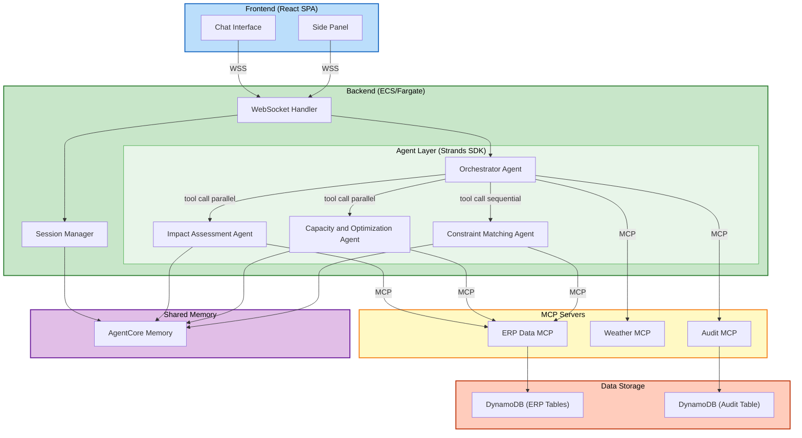

# Component Dependencies — DisruptionAI

## Dependency Matrix

| Component | Depends On | Communication | Data Flow |
|-----------|-----------|---------------|-----------|
| Chat Interface | WebSocket Handler | WebSocket (WSS) | Sends user messages, receives streamed tokens |
| Side Panel | WebSocket Handler | WebSocket (WSS) | Sends approval decisions, receives tracker updates |
| WebSocket Handler | Orchestrator Agent, Session Manager | Python function call | Routes messages to Orchestrator, manages sessions |
| Session Manager | AgentCore Memory | AWS SDK | Read/write shared agent context |
| Orchestrator Agent | Impact Assessment Agent, Capacity & Optimization Agent, Constraint Matching Agent | Strands SDK tool call | Invokes agents, receives results |
| Orchestrator Agent | Audit MCP Server | MCP tool call | Writes audit entries |
| Orchestrator Agent | Weather MCP Server | MCP tool call | Checks disruption events |
| Impact Assessment Agent | ERP Data MCP Server | MCP tool call | Reads Florida orders, updates priority |
| Impact Assessment Agent | AgentCore Memory | AWS SDK | Writes prioritized orders to shared context |
| Capacity & Optimization Agent | ERP Data MCP Server | MCP tool call | Reads capacity, manpower, materials, Ohio orders |
| Capacity & Optimization Agent | AgentCore Memory | AWS SDK | Writes capacity snapshot to shared context |
| Constraint Matching Agent | ERP Data MCP Server | MCP tool call | Reads orders, updates running tracker |
| Constraint Matching Agent | AgentCore Memory | AWS SDK | Reads prioritized orders and capacity snapshot |
| ERP Data MCP Server | DynamoDB | AWS SDK (boto3) | CRUD on mock ERP tables |
| Audit MCP Server | DynamoDB | AWS SDK (boto3) | CRUD on audit table |
| Weather MCP Server | (none) | In-memory | Returns mock weather data |

## Dependency Diagram



### Text Alternative (Dependency Flow)

```
Frontend Layer:
  Chat Interface --WSS--> WebSocket Handler
  Side Panel     --WSS--> WebSocket Handler

Backend Layer:
  WebSocket Handler --> Orchestrator Agent
  WebSocket Handler --> Session Manager
  Session Manager   --> AgentCore Memory

Agent Layer:
  Orchestrator --> Impact Assessment Agent (tool call, parallel)
  Orchestrator --> Capacity & Optimization Agent (tool call, parallel)
  Orchestrator --> Constraint Matching Agent (tool call, sequential)
  Orchestrator --> Audit MCP Server (MCP tool)
  Orchestrator --> Weather MCP Server (MCP tool)

  Impact Assessment Agent      --> ERP Data MCP Server (MCP tool)
  Impact Assessment Agent      --> AgentCore Memory (write)
  Capacity & Optimization Agent --> ERP Data MCP Server (MCP tool)
  Capacity & Optimization Agent --> AgentCore Memory (write)
  Constraint Matching Agent    --> ERP Data MCP Server (MCP tool)
  Constraint Matching Agent    --> AgentCore Memory (read)

Data Layer:
  ERP Data MCP Server --> DynamoDB (ERP Tables)
  Audit MCP Server    --> DynamoDB (Audit Table)
  Weather MCP Server  --> In-memory mock data
```

---

## Critical Dependency Chains

### Chain 1: Disruption Alert
```
Weather MCP --> Orchestrator --> WebSocket Handler --> Chat Interface
```

### Chain 2: Round 1 (Parallel)
```
Orchestrator --parallel--> Impact Assessment Agent      --> ERP Data MCP --> DynamoDB
Orchestrator --parallel--> Capacity & Optimization Agent --> ERP Data MCP --> DynamoDB
Both agents  --> AgentCore Memory (write shared context)
```

### Chain 3: Round 2 (Interactive)
```
Orchestrator --> Capacity & Optimization Agent --> AgentCore Memory (read)
Capacity & Optimization Agent --> ERP Data MCP (identify delays, update tracker)
Capacity & Optimization Agent --> Orchestrator --> WebSocket --> Chat Interface (present delay)
Chat Interface --> WebSocket --> Orchestrator --> Capacity & Optimization Agent (Planner decision)

Orchestrator --> Constraint Matching Agent --> AgentCore Memory (read post-delay capacity)
Constraint Matching Agent --> ERP Data MCP (read orders, update tracker)
Constraint Matching Agent --> Orchestrator --> WebSocket --> Chat Interface (present order)
Chat Interface --> WebSocket --> Orchestrator --> Constraint Matching Agent (Planner decision)
```

### Chain 4: What-If
```
Chat Interface --> WebSocket --> Orchestrator (detect what-if)
Orchestrator --> Capacity & Optimization Agent (re-invoke with modified params)
Capacity & Optimization Agent --> AgentCore Memory (update snapshot)
Orchestrator --> Constraint Matching Agent (re-evaluate current order)
Constraint Matching Agent --> WebSocket --> Chat Interface (updated recommendation)
```

---

## Deployment Dependencies

| Component | Deployment Target | Port/Protocol |
|-----------|------------------|---------------|
| React SPA | S3 + CloudFront | HTTPS (443) |
| WebSocket Handler | ECS/Fargate | WSS via API Gateway |
| Orchestrator + Agents | ECS/Fargate (same container) | Internal |
| ERP Data MCP Server | ECS/Fargate (sidecar or subprocess) | stdio |
| Weather MCP Server | ECS/Fargate (sidecar or subprocess) | stdio |
| Audit MCP Server | ECS/Fargate (sidecar or subprocess) | stdio |
| Session Manager | ECS/Fargate (same container) | Internal |
| AgentCore Memory | AWS Managed Service | AWS SDK |
| DynamoDB | AWS Managed Service | AWS SDK |
