# Execution Plan — DisruptionAI

## Detailed Analysis Summary

### Change Impact Assessment
- **User-facing changes**: Yes — new conversational AI co-pilot with streaming UI
- **Structural changes**: Yes — 4-agent architecture, multi-component system
- **Data model changes**: Yes — new DynamoDB tables for orders, capacity, audit
- **API changes**: Yes — WebSocket API for streaming, agent tool interfaces
- **NFR impact**: Yes — performance (streaming), security (SECURITY extension), scalability (ECS)

### Risk Assessment
- **Risk Level**: Medium
- **Rollback Complexity**: Easy (greenfield, no existing system to break)
- **Testing Complexity**: Complex (multi-agent coordination, constraint matching logic)

## Workflow Visualization

```mermaid
flowchart TD
    Start(["User Request"])

    subgraph INCEPTION["INCEPTION PHASE"]
        WD["Workspace Detection<br/>COMPLETED"]
        RE["Reverse Engineering<br/>SKIP"]
        RA["Requirements Analysis<br/>COMPLETED"]
        US["User Stories<br/>COMPLETED"]
        WP["Workflow Planning<br/>COMPLETED"]
        AD["Application Design<br/>EXECUTE"]
        UG["Units Generation<br/>EXECUTE"]
    end

    subgraph CONSTRUCTION["CONSTRUCTION PHASE"]
        FD["Functional Design<br/>EXECUTE"]
        NFRA["NFR Requirements<br/>EXECUTE"]
        NFRD["NFR Design<br/>EXECUTE"]
        ID["Infrastructure Design<br/>EXECUTE"]
        CP["Code Planning<br/>EXECUTE"]
        CG["Code Generation<br/>EXECUTE"]
        BT["Build and Test<br/>EXECUTE"]
    end

    subgraph OPERATIONS["OPERATIONS PHASE"]
        OPS["Operations<br/>PLACEHOLDER"]
    end

    Start --> WD
    WD --> RA
    RA --> US
    US --> WP
    WP --> AD
    AD --> UG
    UG --> FD
    FD --> NFRA
    NFRA --> NFRD
    NFRD --> ID
    ID --> CP
    CP --> CG
    CG --> BT
    BT --> End(["Complete"])

    style WD fill:#4CAF50,stroke:#1B5E20,stroke-width:3px,color:#fff
    style RA fill:#4CAF50,stroke:#1B5E20,stroke-width:3px,color:#fff
    style US fill:#4CAF50,stroke:#1B5E20,stroke-width:3px,color:#fff
    style WP fill:#4CAF50,stroke:#1B5E20,stroke-width:3px,color:#fff
    style AD fill:#FFA726,stroke:#E65100,stroke-width:3px,stroke-dasharray: 5 5,color:#000
    style UG fill:#FFA726,stroke:#E65100,stroke-width:3px,stroke-dasharray: 5 5,color:#000
    style RE fill:#BDBDBD,stroke:#424242,stroke-width:2px,stroke-dasharray: 5 5,color:#000
    style FD fill:#FFA726,stroke:#E65100,stroke-width:3px,stroke-dasharray: 5 5,color:#000
    style NFRA fill:#FFA726,stroke:#E65100,stroke-width:3px,stroke-dasharray: 5 5,color:#000
    style NFRD fill:#FFA726,stroke:#E65100,stroke-width:3px,stroke-dasharray: 5 5,color:#000
    style ID fill:#FFA726,stroke:#E65100,stroke-width:3px,stroke-dasharray: 5 5,color:#000
    style CP fill:#4CAF50,stroke:#1B5E20,stroke-width:3px,color:#fff
    style CG fill:#4CAF50,stroke:#1B5E20,stroke-width:3px,color:#fff
    style BT fill:#4CAF50,stroke:#1B5E20,stroke-width:3px,color:#fff
    style OPS fill:#BDBDBD,stroke:#424242,stroke-width:2px,stroke-dasharray: 5 5,color:#000
    style Start fill:#CE93D8,stroke:#6A1B9A,stroke-width:3px,color:#000
    style End fill:#CE93D8,stroke:#6A1B9A,stroke-width:3px,color:#000
    style INCEPTION fill:#BBDEFB,stroke:#1565C0,stroke-width:3px,color:#000
    style CONSTRUCTION fill:#C8E6C9,stroke:#2E7D32,stroke-width:3px,color:#000
    style OPERATIONS fill:#FFF59D,stroke:#F57F17,stroke-width:3px,color:#000

    linkStyle default stroke:#333,stroke-width:2px
```




### Text Alternative (Workflow)
```
INCEPTION PHASE:
- Workspace Detection: COMPLETED
- Reverse Engineering: SKIP (Greenfield)
- Requirements Analysis: COMPLETED
- User Stories: COMPLETED
- Workflow Planning: COMPLETED
- Application Design: EXECUTE
- Units Generation: EXECUTE

CONSTRUCTION PHASE (per-unit):
- Functional Design: EXECUTE
- NFR Requirements: EXECUTE
- NFR Design: EXECUTE
- Infrastructure Design: EXECUTE
- Code Planning: EXECUTE (always)
- Code Generation: EXECUTE (always)
- Build and Test: EXECUTE (always)

OPERATIONS PHASE:
- Operations: PLACEHOLDER
```

## Phases to Execute

### INCEPTION PHASE
- [x] Workspace Detection (COMPLETED)
- [x] Reverse Engineering (SKIPPED — Greenfield)
- [x] Requirements Analysis (COMPLETED)
- [x] User Stories (COMPLETED)
- [x] Workflow Planning (IN PROGRESS)
- [ ] Application Design - EXECUTE
  - **Rationale**: 4-agent architecture requires component design, tool interfaces, orchestration patterns
- [ ] Units Generation - EXECUTE
  - **Rationale**: System decomposes into multiple units (backend, frontend, data, infra)

### CONSTRUCTION PHASE
- [ ] Functional Design - EXECUTE (per-unit)
  - **Rationale**: Complex business logic (4-layer constraint funnel, priority algorithm, capacity calculations)
- [ ] NFR Requirements - EXECUTE (per-unit)
  - **Rationale**: Performance (streaming <100ms), security (SECURITY extension), scalability (ECS auto-scaling)
- [ ] NFR Design - EXECUTE (per-unit)
  - **Rationale**: Streaming patterns, caching, rate limiting, security controls
- [ ] Infrastructure Design - EXECUTE (per-unit)
  - **Rationale**: ECS/Fargate, DynamoDB, API Gateway WebSocket, S3 — all need mapping
- [ ] Code Planning - EXECUTE (ALWAYS)
  - **Rationale**: Implementation approach needed for each unit
- [ ] Code Generation - EXECUTE (ALWAYS)
  - **Rationale**: Code implementation needed
- [ ] Build and Test - EXECUTE (ALWAYS)
  - **Rationale**: Build, test, and verification needed

### OPERATIONS PHASE
- [ ] Operations - PLACEHOLDER
  - **Rationale**: Future deployment and monitoring workflows

## Estimated Timeline
- **Total Stages**: 13 (5 completed, 8 remaining)
- **Estimated Duration**: 
  - Application Design: 1-2 sessions
  - Units Generation: 1 session
  - Per-Unit Design (4 stages x ~3 units): 3-4 sessions
  - Code Generation: 2-3 sessions
  - Build and Test: 1 session
  - **Total**: ~8-11 sessions

## Success Criteria
- **Primary Goal**: Working MVP of DisruptionAI with 4-agent architecture
- **Key Deliverables**:
  - 4 functional agents (Orchestrator, Production Order, Capacity, Scheduler)
  - React frontend with streaming chat and side panel approval
  - DynamoDB data layer with mock ERP data
  - ECS/Fargate deployment with WebSocket API
  - Audit trail persistence
- **Quality Gates**:
  - All SECURITY extension rules pass
  - 4-layer constraint funnel works end-to-end
  - Streaming responses render in <100ms
  - What-if recalculation works
