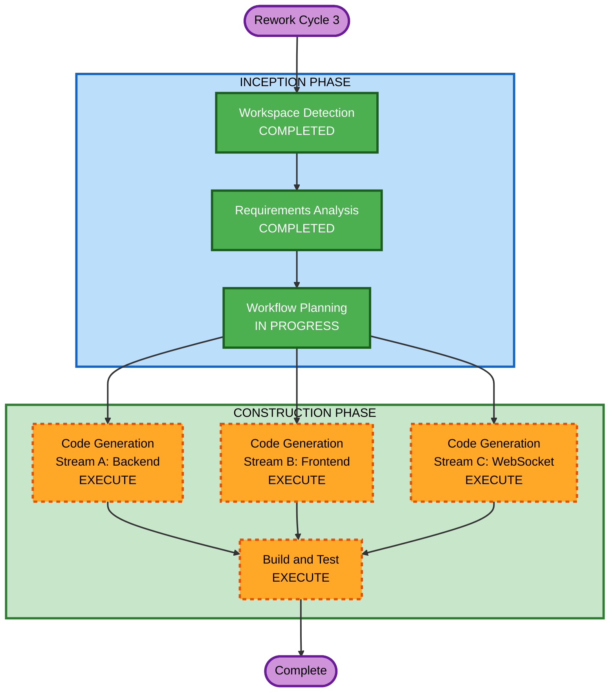

# Rework Cycle 3 — Execution Plan

## Detailed Analysis Summary

### Transformation Scope
- **Transformation Type**: Multi-component bug fix + feature enhancement
- **Primary Changes**: Backend agent config/tool refactoring + major frontend UI overhaul
- **Related Components**: 4 agent packages, orchestrator, WebSocket Lambda, frontend SPA

### Change Impact Assessment
- **User-facing changes**: Yes — complete frontend UI overhaul with new visualization panels
- **Structural changes**: Yes — data staging pattern replaces direct JSON passing in tools
- **Data model changes**: No — ERP data models unchanged
- **API changes**: Yes — tool parameter renaming (plant-agnostic), new WebSocket message types
- **NFR impact**: Yes — max_tokens increases, retry delay, new charting dependency

### Risk Assessment
- **Risk Level**: Medium
- **Rollback Complexity**: Moderate (backend changes are config-level; frontend is additive)
- **Testing Complexity**: Moderate (backend needs E2E agent test; frontend needs visual verification)

## Workflow Visualization



### Text Alternative
```
INCEPTION PHASE
  - Workspace Detection (COMPLETED)
  - Requirements Analysis (COMPLETED)
  - Workflow Planning (IN PROGRESS)

CONSTRUCTION PHASE
  - Code Generation Stream A: Backend Agent Fixes (EXECUTE)
  - Code Generation Stream B: Frontend UI Overhaul (EXECUTE)
  - Code Generation Stream C: WebSocket Lambda Updates (EXECUTE)
  - Build and Test (EXECUTE)
```

## Phases to Execute

### INCEPTION PHASE
- [x] Workspace Detection (COMPLETED — Brownfield)
- [x] Requirements Analysis (COMPLETED — 14 requirements documented)
- [x] Workflow Planning (IN PROGRESS)
- User Stories — SKIP
  - **Rationale**: Bug fix + targeted enhancement rework; existing stories from Cycle 1 still apply
- Application Design — SKIP
  - **Rationale**: No new components; modifying existing agent tools and frontend components
- Units Generation — SKIP
  - **Rationale**: Existing unit structure unchanged; work organized as code generation streams

### CONSTRUCTION PHASE
- Functional Design — SKIP
  - **Rationale**: Backend changes are config/refactoring (max_tokens, data staging pattern, parameter renaming); frontend changes are UI component work with clear requirements
- NFR Requirements — SKIP
  - **Rationale**: NFR decisions already made in requirements (max_tokens values, retry delay, charting library choice)
- NFR Design — SKIP
  - **Rationale**: No new NFR patterns needed; existing patterns (fail-closed, structured logging) maintained
- Infrastructure Design — SKIP
  - **Rationale**: No new infrastructure; WebSocket Lambda inline code update only
- Code Generation — EXECUTE (3 streams)
  - **Stream A — Backend**: Modify 4 agent files + orchestrator config + system prompts + funnel module
  - **Stream B — Frontend**: Overhaul chat rendering, fix side panel components, add new visualization views, add charting library
  - **Stream C — WebSocket**: Update Lambda to parse agent output for phase/capacity/approval signals
- Build and Test — EXECUTE
  - **Rationale**: Verify backend agent changes, frontend build, deployment instructions

## Code Generation Streams

### Stream A: Backend Agent Fixes (REQ-B01 through REQ-B06)
1. Increase max_tokens: impact (4096→8192), capacity (4096→8192), constraint (4096→8192)
2. Increase orchestrator max_tokens (8192→16384)
3. Add retry delay (30s) to orchestrator sub-agent invocation
4. Fix concurrency: create new agent instances per invocation in orchestrator
5. Add data staging tool pattern to all 3 sub-agents
6. Rename plant-specific parameters to generic names
7. Update system prompts for plant-agnostic operation

### Stream B: Frontend UI Overhaul (REQ-F01 through REQ-F08)
1. Fix ChatMessage rendering (tables, collapsible sections, agent badges)
2. Add Recharts dependency for interactive visualizations
3. Fix PhaseProgressBar to parse stream for phase keywords
4. Fix CapacityTracker to display data from parsed agent output
5. Fix ApprovalCard to surface order decisions from agent output
6. Add SubAgentStatus component
7. Add OrderHistory component
8. Add visualization views (CascadeImpactView, ScorecardView, TransferFlowView)
9. Update SidePanel with tab navigation for new views
10. Update Zustand store with new state slices
11. Update TypeScript types
12. Tablet responsive adjustments

### Stream C: WebSocket Lambda Updates (supports REQ-F02, F03, F04, F05)
1. Parse agent stream output for phase transition markers
2. Extract capacity data from agent responses
3. Detect order decision points and emit structured messages
4. Detect sub-agent invocation markers and emit agent_switch messages

## Estimated Timeline
- **Total Stages**: 2 (Code Generation + Build and Test)
- **Code Generation Steps**: ~25 steps across 3 streams
- **Estimated Duration**: Significant — frontend visualization work is the largest effort

## Success Criteria
- **Primary Goal**: Fix all 3 backend agent failure modes; deliver functional frontend with interactive visualizations
- **Key Deliverables**: Working agents with data staging, plant-agnostic tools; frontend with phase progress, capacity tracker, approval cards, visualization dashboards
- **Quality Gates**: All existing tests pass, new tool interfaces validated, frontend builds cleanly, security compliance maintained
