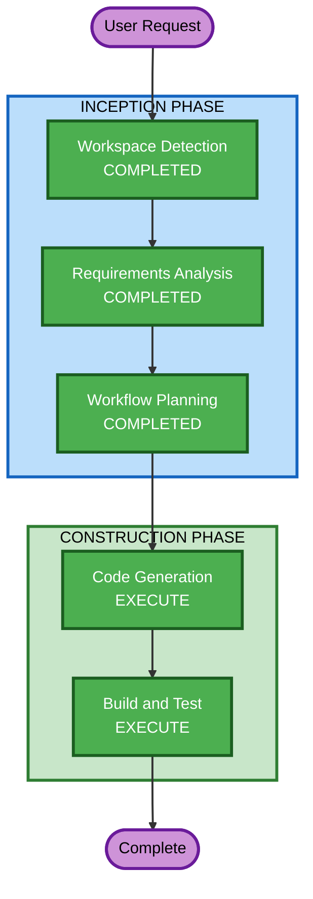

# Rework Cycle 4 — Execution Plan

## Detailed Analysis Summary

### Transformation Scope
- **Transformation Type**: Architectural enhancement — new UI paradigm (dashboard-first), new workflow pattern (two-persona handshake), data layer expansion (Florida plant seed data)
- **Primary Changes**: Frontend overhaul (dashboard landing page, two planner views, notification system, handshake UI), orchestrator workflow changes (planner-scoped sessions, transfer negotiation), capacity agent tuning, Cognito user attributes, ERP seed data expansion
- **Related Components**: Frontend SPA, Orchestrator Agent, Capacity Optimization Agent, ERP Data MCP (seed data), Cognito Stack (CDK), REST Proxy

### Change Impact Assessment
- **User-facing changes**: Yes — Complete UI paradigm shift from chat-first to dashboard-first with two distinct planner personas
- **Structural changes**: Yes — New dashboard components, notification system, handshake approval workflow, transfer negotiation channel
- **Data model changes**: Yes — Florida plant capacity/manpower/materials seed data, new order statuses (Transferred, Suspended, De-prioritized), Cognito custom attributes
- **API changes**: Moderate — REST proxy needs to pass planner identity, orchestrator needs plant-scoped context
- **NFR impact**: Yes — Dashboard load performance, real-time notifications, planner data isolation

### Component Relationships
- **Frontend SPA** → REST Proxy → Orchestrator Agent → Sub-agents (Impact Assessment, Capacity Optimization, Constraint Matching) → ERP Data MCP (via Gateway)
- **Cognito Stack** → Frontend Auth → REST Proxy (planner identity passthrough)
- **ERP Data MCP** → DynamoDB (new Florida plant data)

### Risk Assessment
- **Risk Level**: Medium-High — Multiple interacting features across all layers, UI paradigm shift
- **Rollback Complexity**: Moderate — Frontend can be rolled back independently, backend changes are additive
- **Testing Complexity**: Complex — Two-persona scenarios, handshake workflow, notification timing

## Workflow Visualization



### Text Alternative
```
INCEPTION PHASE:
  Workspace Detection    → COMPLETED
  Requirements Analysis  → COMPLETED (13 FR + 5 NFR)
  Workflow Planning      → COMPLETED

CONSTRUCTION PHASE:
  Code Generation        → EXECUTE (4 streams)
  Build and Test         → EXECUTE
```

## Phases to Execute

### INCEPTION PHASE
- [x] Workspace Detection (COMPLETED)
- [x] Reverse Engineering — SKIP (artifacts exist from prior cycles)
- [x] Requirements Analysis (COMPLETED — 13 FR + 5 NFR)
- [x] User Stories — SKIP (personas well-understood: Ohio Planner, Miami Planner; prior stories exist)
- [x] Workflow Planning (IN PROGRESS)
- [x] Application Design — SKIP (existing component architecture sufficient; changes are within existing boundaries)
- [x] Units Generation — SKIP (single rework cycle, streams defined below)

### CONSTRUCTION PHASE
- [ ] Functional Design — SKIP (business logic well-defined in requirements; existing FD artifacts cover base patterns)
- [ ] NFR Requirements — SKIP (NFRs defined in requirements doc; existing NFR patterns apply)
- [ ] NFR Design — SKIP (existing NFR design patterns from prior cycles apply)
- [ ] Infrastructure Design — SKIP (Cognito attribute is a minor CDK change; no new infrastructure services)
- [ ] Code Generation — EXECUTE (4 parallel streams)
- [ ] Build and Test — EXECUTE

## Code Generation Streams

### Stream A: Data Layer & Capacity Tuning (FR-11, FR-12)
1. Add Florida plant seed data (capacity, manpower, materials) to `erp-data-mcp/src/erp_data_mcp/seed/data.py`
2. Adjust Ohio plant utilization rates to 80-82% Rolling Mill, 80% Finishing Line
3. Add ERP Data MCP tools for querying plant-specific data (if not already plant-filtered)
4. Re-seed DynamoDB tables

### Stream B: Cognito & REST Proxy (FR-01, FR-10, NFR-03)
5. Add custom `plant` attribute to Cognito User Pool (CDK)
6. Update REST proxy to extract and pass planner identity (plant attribute) to orchestrator
7. Create admin script to set plant attribute on existing users

### Stream C: Frontend Dashboard & Notifications (FR-02, FR-03, FR-04, FR-05, FR-13)
8. Create dashboard landing page with tab navigation (Dashboard / Chat / Transfer Negotiation)
9. Build Job Status Tracking view (active orders table, historical toggle, summary cards)
10. Build Operational Efficiency Monitoring view (utilization gauges, manpower bar, material levels, equipment status, summary cards, trend charts)
11. Implement disruption notification banner (persistent until acknowledged, facility-scoped)
12. Build post-workflow end-state dashboard (FR-13: Miami zeroed-out, Ohio absorbed + de-prioritized)
13. Update Zustand store with planner identity, dashboard state, notification state
14. Wire plant attribute from Cognito into store after auth

### Stream D: Handshake Workflow & Orchestrator (FR-06, FR-07, FR-08, FR-09)
15. Update orchestrator system prompt for two-persona awareness (plant-scoped responses)
16. Add transfer proposal rendering in Miami planner's view (AI proposes → Miami confirms)
17. Build Ohio planner's pending transfers view (approve/decline with reason)
18. Implement decline-and-resubmit flow (Miami notified, can modify and resubmit)
19. Build shared Transfer Negotiation channel view (read-only status tracker)
20. Update orchestrator to handle plant-scoped sessions and transfer state

### Stream Dependencies
```
Stream A (Data) ──→ Stream C (Frontend needs data to display)
Stream B (Auth) ──→ Stream C (Frontend needs plant identity)
Stream A (Data) ──→ Stream D (Orchestrator needs plant-scoped data)
Stream B (Auth) ──→ Stream D (Orchestrator needs planner identity)
```

**Execution Order**: A + B first (parallel), then C + D (parallel, depend on A + B)

## Estimated Timeline
- **Stream A**: ~15 steps (seed data, capacity tuning)
- **Stream B**: ~5 steps (Cognito, REST proxy)
- **Stream C**: ~25 steps (dashboard, notifications, end-state)
- **Stream D**: ~15 steps (handshake workflow, orchestrator)
- **Build and Test**: ~10 steps

## Success Criteria
- **Primary Goal**: Two-persona dashboard demo with full disruption workflow
- **Key Deliverables**: Dashboard landing page, job tracking, efficiency monitoring, notification banner, handshake approval, post-workflow end-state view
- **Quality Gates**: Both planner views render correctly, handshake workflow completes, capacity shows realistic utilization, end-state dashboard reflects transferred/de-prioritized orders

## Extension Compliance
| Extension | Status | Applicability |
|-----------|--------|---------------|
| Security Baseline | Enabled | Applicable — Cognito attributes, data isolation, REST proxy changes |
