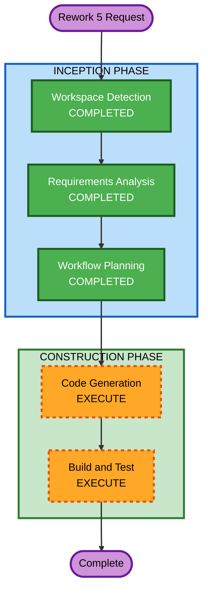

# Execution Plan — Rework 5: UI-Driven Disruption Workflow

## Detailed Analysis Summary

### Transformation Scope
- **Transformation Type**: Frontend UI rework (single component scope — frontend-spa)
- **Primary Changes**: New disruption wizard page, new navigation item, new components (stepper, card queue, Kanban board, split-view), store extensions, response parser updates
- **Related Components**: frontend-spa only — no backend or infrastructure changes

### Change Impact Assessment
- **User-facing changes**: Yes — entirely new disruption workflow UX replacing chat-based flow
- **Structural changes**: No — no architectural changes, same multi-agent backend
- **Data model changes**: No — no DynamoDB or API schema changes
- **API changes**: No — same HTTP POST to streaming proxy, same response format
- **NFR impact**: Minimal — accessibility for new components, responsive layout

### Component Relationships
- **Primary Component**: frontend-spa
- **Unchanged**: orchestrator-agent, impact-assessment-agent, capacity-optimization-agent, constraint-matching-agent, erp-data-mcp, audit-mcp, infrastructure/*

### Risk Assessment
- **Risk Level**: Medium — significant UI rework but isolated to frontend
- **Rollback Complexity**: Easy — revert frontend code, backend untouched
- **Testing Complexity**: Moderate — new components need unit tests, integration with existing streaming/parsing

## Workflow Visualization



### Text Alternative
```
Phase 1: INCEPTION
  - Workspace Detection (COMPLETED)
  - Requirements Analysis (COMPLETED)
  - Workflow Planning (COMPLETED)

Phase 2: CONSTRUCTION
  - Code Generation (EXECUTE)
  - Build and Test (EXECUTE)
```

## Phases to Execute

### INCEPTION PHASE
- [x] Workspace Detection (COMPLETED)
- [x] Reverse Engineering — SKIP (brownfield artifacts exist)
- [x] Requirements Analysis (COMPLETED) — 13 FR + 5 NFR
- [x] User Stories — SKIP (rework of existing feature, clear requirements)
- [x] Workflow Planning (COMPLETED)
- [x] Application Design — SKIP (no new backend components, frontend-only changes within existing architecture)
- [x] Units Generation — SKIP (single unit: frontend-spa)

### CONSTRUCTION PHASE
- [x] Functional Design — SKIP (business logic unchanged, UI presentation layer only)
- [x] NFR Requirements — SKIP (existing NFR setup sufficient, minimal NFR impact)
- [x] NFR Design — SKIP (no new NFR patterns needed)
- [x] Infrastructure Design — SKIP (no infrastructure changes)
- [ ] Code Generation — EXECUTE (ALWAYS)
  - **Rationale**: New frontend components, store changes, parser updates needed
- [ ] Build and Test — EXECUTE (ALWAYS)
  - **Rationale**: Build verification and test execution needed

### OPERATIONS PHASE
- [ ] Operations — PLACEHOLDER

## Code Generation Streams

### Stream A: Store & Types (Foundation)
New types and store slices for disruption workflow state.

### Stream B: Disruption Page Components
New components: DisruptionPage, PhaseSteppper, DisruptionLanding, Round1SplitView, DelayCardQueue, ConstraintFunnelView, KanbanBoard.

### Stream C: Navigation & Integration
AppHeader nav update, MainLayout routing, response parser extensions, what-if chat integration.

## Success Criteria
- **Primary Goal**: Disruption workflow operates via dedicated UI page instead of chat
- **Key Deliverables**: DisruptionPage with all phase views, Kanban board, card queues, phase stepper
- **Quality Gates**: All existing tests pass, new component tests pass, TypeScript compiles clean

## Extension Compliance
| Extension | Status | Rationale |
|-----------|--------|-----------|
| Security Baseline | Compliant | No new endpoints, existing auth preserved, input sanitization maintained |
