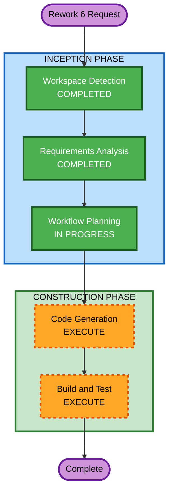

# Execution Plan — Rework 6: Structured JSON Response Pipeline

## Detailed Analysis Summary

### Transformation Scope
- **Transformation Type**: Pipeline rework across 3 layers (orchestrator, proxy, frontend)
- **Primary Changes**: Replace regex-based text parsing with tool-call-driven structured JSON
- **Related Components**: orchestrator-agent, infrastructure/streaming-proxy, frontend-spa

### Change Impact Assessment
- **User-facing changes**: No — same UI, same data, different delivery mechanism
- **Structural changes**: Yes — new `update_ui` tool on orchestrator, proxy response format change
- **Data model changes**: Yes — new `UiPayload` Pydantic model + TypeScript interface
- **API changes**: Yes — Lambda proxy changes from SSE to JSON response format
- **NFR impact**: Minimal — buffering tradeoff acceptable, security validation added

### Component Relationships
- **Primary**: orchestrator-agent (tool registration, envelope construction)
- **Infrastructure**: streaming-proxy Lambda (response format change)
- **Frontend**: streaming.ts, responseParser.ts, 4 disruption components
- **Unaffected**: sub-agents (impact-assessment, capacity-optimization, constraint-matching), MCP servers, CDK stacks, Cognito, DynamoDB

### Risk Assessment
- **Risk Level**: Medium
- **Rollback Complexity**: Moderate — revert 3 layers simultaneously
- **Testing Complexity**: Moderate — need end-to-end validation of pipeline

## Workflow Visualization

## Phases to Execute

### INCEPTION PHASE
- [x] Workspace Detection (COMPLETED)
- [x] Requirements Analysis (COMPLETED) — 11 FR + 5 NFR
- [x] Workflow Planning (IN PROGRESS)
- [x] User Stories — SKIP
  - **Rationale**: No new user personas or workflows. Same Planner experience, different data delivery.
- [x] Application Design — SKIP
  - **Rationale**: No new components. `update_ui` is a local tool on the existing orchestrator, not a new service.
- [x] Units Generation — SKIP
  - **Rationale**: Single logical unit of work spanning 3 layers. No decomposition needed.

### CONSTRUCTION PHASE
- [x] Functional Design — SKIP
  - **Rationale**: Business logic unchanged. The `UiPayload` schema is fully defined in FR-02.
- [x] NFR Requirements — SKIP
  - **Rationale**: NFRs defined in requirements (NFR-01 through NFR-05). No new tech stack decisions.
- [x] NFR Design — SKIP
  - **Rationale**: Existing patterns (Pydantic validation, structured logging) apply directly.
- [x] Infrastructure Design — SKIP
  - **Rationale**: No new AWS resources. Lambda proxy code change only, no CDK changes.
- [ ] Code Generation — EXECUTE (ALWAYS)
  - **Rationale**: Implementation required across orchestrator, proxy, and frontend
- [ ] Build and Test — EXECUTE (ALWAYS)
  - **Rationale**: Build verification and test instructions needed

## Code Generation Streams

The code generation will be organized into 3 streams following the pipeline order:

### Stream A: Orchestrator Backend (Python)
1. Add `UiPayload` Pydantic model to `models/schemas.py`
2. Create `update_ui` tool in `agent.py` with accumulator
3. Update `agentcore_server.py` to collect tool results and build envelope
4. Update system prompt to instruct LLM to use `update_ui`
5. Delete `json_extractor.py`
6. Update orchestrator tests

### Stream B: Lambda Streaming Proxy (Node.js)
7. Rewrite `index.mjs` to buffer AgentCore response, parse envelope, forward JSON
8. Add `ui` field validation and sanitization

### Stream C: Frontend (TypeScript/React)
9. Add `UiPayload` TypeScript interface to types
10. Simplify `streaming.ts` `handleCompleteResponse()` — remove all regex/fallback paths
11. Refactor `responseParser.ts` — remove regex extraction, consume `uiData` only
12. Update `Round1SplitView.tsx` — render from `uiData`
13. Update `DelayCardQueue.tsx` — render from `uiData`
14. Update `ConstraintFunnelView.tsx` — render from `uiData`
15. Update `Round1ResultsCard.tsx` — render from `uiData`

### Total: 15 steps

## Success Criteria
- **Primary Goal**: `ui` field survives orchestrator → AgentCore → Lambda proxy → browser
- **Key Deliverables**: Working pipeline with no regex parsing in disruption components
- **Quality Gates**: All existing tests pass, new tests for `update_ui` tool and simplified response handling
