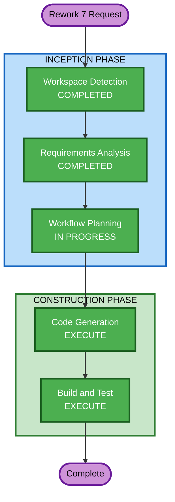

# Execution Plan — Rework 7: Transfer Negotiation, Live Capacity Impact & Cross-Plant Dashboard Updates

## Detailed Analysis Summary

### Transformation Scope
- **Transformation Type**: Multi-component enhancement (frontend-heavy with backend schema extensions)
- **Primary Changes**: Transfer Negotiation rework (accept/reject flow), new CapacityImpactPanel, disruption stepper extension, cross-plant WebSocket push, bidirectional role logic
- **Related Components**: Orchestrator agent (update_ui schema), Lambda proxy (passthrough), Frontend (store, types, 6+ components), ERP Data MCP (transfer status tool)

### Change Impact Assessment
- **User-facing changes**: Yes — new three-column layout during disruption, Transfer Negotiation accept/reject UI, capacity summary stepper step, cross-plant dashboard sync
- **Structural changes**: No — no new services or architectural changes; extends existing patterns
- **Data model changes**: Minor — new fields on UiPayload (capacityImpact, transferOrders), new transfer status values
- **API changes**: No — all communication via existing WebSocket; update_ui tool extended with new optional fields
- **NFR impact**: Yes — real-time cross-plant updates via WebSocket push, three-column layout performance

### Component Relationships
- **Primary Components**: Frontend SPA (store, types, disruption components, transfer components, dashboard components)
- **Backend Components**: Orchestrator agent (schemas, system prompt), Lambda streaming proxy (passthrough)
- **Data Components**: ERP Data MCP (transfer status update tool)
- **Dependent Components**: responseParser.ts (new uiData fields), streaming.ts (WebSocket push events)

### Risk Assessment
- **Risk Level**: Medium
- **Rollback Complexity**: Moderate — frontend changes are isolated; backend schema extensions are additive (backward compatible)
- **Testing Complexity**: Moderate — cross-plant WebSocket push requires multi-session testing

## Workflow Visualization



### Text Alternative
```
INCEPTION PHASE:
  - Workspace Detection: COMPLETED
  - Requirements Analysis: COMPLETED (15 FR + 5 NFR)
  - Workflow Planning: IN PROGRESS
  
CONSTRUCTION PHASE:
  - Code Generation: EXECUTE (4 parallel streams, ~20 steps)
  - Build and Test: EXECUTE
```

## Phases to Execute

### INCEPTION PHASE
- [x] Workspace Detection — COMPLETED (Brownfield)
- [x] Requirements Analysis — COMPLETED (15 FR + 5 NFR approved)
- [x] Workflow Planning — IN PROGRESS
- User Stories — SKIP (existing personas unchanged; requirements are clear and implementation-focused)
- Application Design — SKIP (no new components/services; extending existing patterns)
- Units Generation — SKIP (single logical unit of work across existing components)

### CONSTRUCTION PHASE
- Functional Design — SKIP (business logic is straightforward: auto-flow transfers, accept/reject, dashboard sync)
- NFR Requirements — SKIP (existing NFR setup sufficient; new NFRs documented in requirements)
- NFR Design — SKIP (no new NFR patterns needed; existing security baseline applies)
- Infrastructure Design — SKIP (no infrastructure changes; all communication via existing WebSocket)
- [x] Code Generation — EXECUTE (4 parallel streams)
- [ ] Build and Test — EXECUTE

## Code Generation Streams

### Stream A: Backend — Orchestrator Schema & Prompt Updates (3 steps)
Extends the update_ui Pydantic schema with `capacityImpact` and `transferOrders` fields. Updates system prompt to instruct LLM when to emit these fields. Ensures Lambda proxy passes through new fields.

**Files**: `orchestrator-agent/src/orchestrator_agent/models/schemas.py`, `orchestrator-agent/src/orchestrator_agent/prompts/system_prompt.py`, `infrastructure/streaming-proxy/index.mjs`

### Stream B: Frontend — Types, Store & Response Parser (4 steps)
Adds TypeScript types for CapacityImpact, TransferOrder. Extends store with transfer lifecycle state, capacity impact tracking, cross-plant update actions. Updates responseParser to handle new uiData fields. Updates streaming.ts for WebSocket push events.

**Files**: `frontend-spa/src/types/index.ts`, `frontend-spa/src/store/index.ts`, `frontend-spa/src/lib/responseParser.ts`, `frontend-spa/src/lib/streaming.ts`

### Stream C: Frontend — Disruption UI (Live Capacity Impact + Summary Step) (5 steps)
Creates CapacityImpactPanel component with gauges + delta preview. Updates DisruptionPage to three-column layout during delay/funnel phases. Creates CapacitySummaryStep component. Updates PhaseStepper with new "Capacity Summary" step. Adds bidirectional label logic.

**Files**: `frontend-spa/src/components/disruption/CapacityImpactPanel.tsx` (CREATE), `frontend-spa/src/components/disruption/DisruptionPage.tsx`, `frontend-spa/src/components/disruption/CapacitySummaryStep.tsx` (CREATE), `frontend-spa/src/components/disruption/PhaseStepper.tsx`, `frontend-spa/src/components/disruption/DisruptionLanding.tsx`

### Stream D: Frontend — Transfer Negotiation & Dashboard Updates (5 steps)
Reworks TransferNegotiationView with Incoming/Outgoing tabs, Accept/Reject per order. Updates JobStatusView with "Transferred In" badges and real-time status updates. Updates OperationalEfficiencyView with real-time utilization updates. Adds cross-plant notification logic. Adds ERP Data MCP transfer status tool.

**Files**: `frontend-spa/src/components/transfers/TransferNegotiationView.tsx`, `frontend-spa/src/components/dashboard/JobStatusView.tsx`, `frontend-spa/src/components/dashboard/OperationalEfficiencyView.tsx`, `frontend-spa/src/lib/dashboardData.ts`, `erp-data-mcp/src/erp_data_mcp/tools/orders.py`

## Estimated Timeline
- **Total Steps**: ~17 across 4 streams
- **Streams A+B**: Can execute in parallel (no dependencies)
- **Stream C**: Depends on Stream B (types + store)
- **Stream D**: Depends on Stream B (types + store)

## Success Criteria
- Funnel-approved orders auto-appear in Transfer Negotiation as "Submitted for Review"
- Receiving plant can accept/reject transfers with optional reason
- Both plants' dashboards update in real-time via WebSocket push
- Live capacity impact panel shows gauges + delta during delay/funnel phases
- Final capacity summary step shows receiving plant utilization
- Bidirectional: works for either plant disrupted
- Security baseline compliant (plant-level auth, input sanitization)

## Extension Compliance
| Extension | Enabled | Status |
|-----------|---------|--------|
| Security Baseline | Yes | Compliant — NFR-04 addresses plant auth, WebSocket auth, input sanitization |
